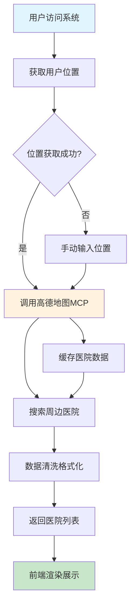
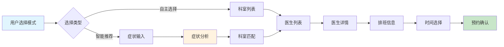
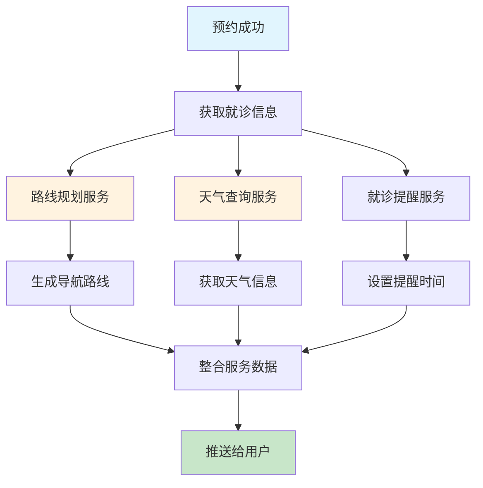
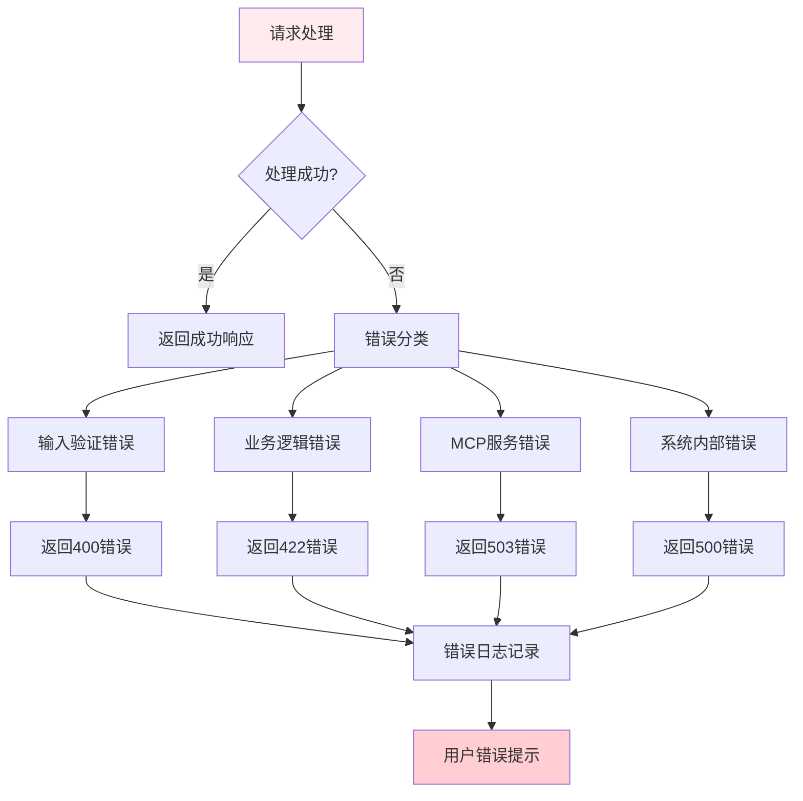

# 智能医生预约挂号系统 - 数据流程图文档

## 📋 文档概述

**文档目的**：展示系统数据流转过程，明确各Agent协作关系  
**目标读者**：开发团队、架构师、项目经理  
**版本历史**：v1.0 - 初始版本

## 🔄 系统整体数据流图

### 数据流总览
```
┌─────────────────────────────────────────────────────────────────────────┐
│                           用户交互层 (User Layer)                         │
├─────────────────────────────────────────────────────────────────────────┤
│  Web前端 │ 移动端App │ 微信小程序 │ 管理后台                              │
└─────────────────────────────────────────────────────────────────────────┘
                              ↓ (HTTP/HTTPS)
┌─────────────────────────────────────────────────────────────────────────┐
│                           API网关层 (Gateway Layer)                      │
├─────────────────────────────────────────────────────────────────────────┤
│  请求路由 │ 身份验证 │ 限流控制 │ 日志记录 │ 数据格式转换                 │
└─────────────────────────────────────────────────────────────────────────┘
                              ↓ (内部API调用)
┌─────────────────────────────────────────────────────────────────────────┐
│                         业务服务层 (Service Layer)                      │
├─────────────────────────────────────────────────────────────────────────┤
│  用户服务 │ 医院服务 │ 预约服务 │ 推荐服务 │ MCP集成服务                  │
└─────────────────────────────────────────────────────────────────────────┘
                              ↓ (数据访问)
┌─────────────────────────────────────────────────────────────────────────┐
│                         数据存储层 (Storage Layer)                       │
├─────────────────────────────────────────────────────────────────────────┤
│  PostgreSQL │ Redis缓存 │ 文件存储 │ MCP缓存                           │
└─────────────────────────────────────────────────────────────────────────┘
                              ↓ (外部服务调用)
┌─────────────────────────────────────────────────────────────────────────┐
│                         MCP服务层 (MCP Layer)                           │
├─────────────────────────────────────────────────────────────────────────┤
│  高德地图API │ Web搜索服务 │ Web爬虫服务 │ 第三方数据源                   │
└─────────────────────────────────────────────────────────────────────────┘
```

## 📊 核心业务流程数据流

### 流程1：用户定位与医院发现流程

#### 数据流程图


#### 数据流详细说明

**前端数据流**：
```javascript
// 前端数据流转
const hospitalDiscoveryFlow = {
  // 1. 用户触发
  userAction: '页面加载/位置授权',
  
  // 2. 位置获取
  locationData: {
    source: '浏览器Geolocation API',
    format: '{latitude: number, longitude: number}',
    processing: '坐标转换和验证'
  },
  
  // 3. API调用
  apiRequest: {
    endpoint: '/api/hospitals/nearby',
    payload: {
      location: '用户坐标',
      radius: '搜索半径',
      filters: '筛选条件'
    }
  },
  
  // 4. 响应处理
  apiResponse: {
    data: '医院列表数据',
    format: '标准化JSON结构',
    processing: '数据解析和状态管理'
  },
  
  // 5. 界面渲染
  uiRender: {
    components: ['HospitalCard', 'MapView', 'Filters'],
    state: '医院列表状态',
    interactions: '点击、筛选、排序'
  }
};
```

**后端数据流**：
```python
# 后端数据流转
class HospitalDiscoveryDataFlow:
    def process_hospital_discovery(self, request_data):
        """处理医院发现请求"""
        
        # 1. 输入验证
        validated_data = self.validate_request(request_data)
        
        # 2. 检查缓存
        cache_key = self.generate_cache_key(validated_data)
        cached_result = cache.get(cache_key)
        if cached_result:
            return self.format_response(cached_result)
        
        # 3. 调用MCP服务
        mcp_service = AmapMCPIntegration()
        raw_hospitals = mcp_service.search_nearby_hospitals(
            location=validated_data['location'],
            radius=validated_data.get('radius', 100000)
        )
        
        # 4. 数据清洗
        cleaned_hospitals = self.clean_hospital_data(raw_hospitals)
        
        # 5. 数据库匹配
        enhanced_hospitals = self.enhance_with_db_data(cleaned_hospitals)
        
        # 6. 缓存结果
        cache.set(cache_key, enhanced_hospitals, timeout=300)  # 5分钟缓存
        
        # 7. 返回响应
        return self.format_response(enhanced_hospitals)
```

#### Agent协作关系
- **前端开发者**：负责位置获取、界面渲染、用户交互
- **后端架构师**：负责API设计、业务逻辑、数据验证
- **MCP集成专家**：负责高德地图API调用、数据解析
- **数据库架构师**：负责缓存策略、数据增强

### 流程2：智能预约选择流程

#### 数据流程图


#### 数据流详细说明

**智能推荐数据流**：
```python
# 智能推荐数据流转
class IntelligentRecommendationFlow:
    def process_symptom_recommendation(self, symptom_text, user_location):
        """处理症状推荐流程"""
        
        # 1. 症状文本处理
        processed_symptoms = self.preprocess_symptoms(symptom_text)
        
        # 2. 关键词提取
        keywords = self.extract_keywords(processed_symptoms)
        
        # 3. Web搜索MCP调用
        web_search_service = WebSearchMCP()
        medical_info = web_search_service.search_medical_info(keywords)
        
        # 4. 疾病-科室映射
        department_mapping = self.map_diseases_to_departments(medical_info)
        
        # 5. 医生推荐计算
        recommendation_engine = DoctorRecommendationEngine()
        recommended_doctors = recommendation_engine.recommend_doctors(
            departments=department_mapping,
            location=user_location,
            user_preferences={}
        )
        
        # 6. 结果格式化
        formatted_results = self.format_recommendation_results(recommended_doctors)
        
        return formatted_results
```

**预约确认数据流**：
```python
# 预约确认数据流转
class AppointmentConfirmationFlow:
    def process_appointment_creation(self, user_id, doctor_id, schedule_data):
        """处理预约创建流程"""
        
        # 1. 数据验证
        validation_result = self.validate_appointment_data(
            user_id, doctor_id, schedule_data
        )
        
        # 2. 时间冲突检查
        conflict_check = self.check_time_conflicts(user_id, schedule_data)
        
        # 3. 医生排班验证
        schedule_validation = self.validate_doctor_schedule(doctor_id, schedule_data)
        
        # 4. 创建预约记录
        appointment = self.create_appointment_record(
            user_id, doctor_id, schedule_data
        )
        
        # 5. 更新排班状态
        self.update_schedule_availability(doctor_id, schedule_data)
        
        # 6. 生成智能服务
        intelligent_services = self.generate_intelligent_services(appointment)
        
        # 7. 返回确认结果
        return {
            'appointment': appointment,
            'services': intelligent_services,
            'confirmation_code': self.generate_confirmation_code()
        }
```

#### Agent协作关系
- **前端开发者**：负责模式选择界面、症状输入、结果展示
- **后端架构师**：负责推荐算法、预约逻辑、数据验证
- **MCP集成专家**：负责Web搜索、医疗信息获取
- **算法工程师**：负责症状分析、推荐模型
- **测试工程师**：负责流程测试、边界条件验证

### 流程3：智能服务集成流程

#### 数据流程图


#### 数据流详细说明

**智能服务数据流**：
```python
# 智能服务数据流转
class IntelligentServicesFlow:
    def generate_appointment_services(self, appointment_id):
        """生成预约相关智能服务"""
        
        # 1. 获取预约详情
        appointment = self.get_appointment_details(appointment_id)
        
        # 2. 并行调用各服务
        route_service = self.call_route_planning(appointment)
        weather_service = self.call_weather_service(appointment)
        reminder_service = self.setup_appointment_reminders(appointment)
        
        # 3. 数据整合
        integrated_services = {
            'navigation': route_service,
            'weather': weather_service,
            'reminders': reminder_service,
            'medical_advice': self.generate_medical_advice(appointment)
        }
        
        # 4. 缓存服务数据
        self.cache_services_data(appointment_id, integrated_services)
        
        # 5. 异步推送
        self.async_push_services_to_user(appointment.user_id, integrated_services)
        
        return integrated_services
    
    def call_route_planning(self, appointment):
        """调用路线规划服务"""
        # 获取用户位置和医院位置
        user_location = self.get_user_current_location(appointment.user_id)
        hospital_location = appointment.hospital.location
        
        # 调用高德地图MCP
        amap_service = AmapMCPIntegration()
        route_options = amap_service.get_route_options(
            origin=user_location,
            destination=hospital_location,
            methods=['driving', 'transit', 'walking']
        )
        
        return {
            'best_route': self.select_best_route(route_options),
            'all_options': route_options,
            'estimated_time': self.calculate_estimated_time(route_options)
        }
```

#### Agent协作关系
- **后端架构师**：负责服务集成、数据协调
- **MCP集成专家**：负责高德地图API、天气API调用
- **前端开发者**：负责服务展示、用户交互
- **移动端开发者**：负责推送通知、本地提醒

## 🔗 Agent间数据交换协议

### 数据格式标准

**API请求格式**：
```json
{
  "request_id": "uuid",
  "timestamp": "2024-01-01T10:00:00Z",
  "source": "frontend/backend/service",
  "payload": {
    "data": {},
    "metadata": {
      "version": "1.0",
      "format": "json"
    }
  }
}
```

**API响应格式**：
```json
{
  "request_id": "uuid",
  "timestamp": "2024-01-01T10:00:01Z",
  "status": "success/error",
  "data": {},
  "pagination": {},
  "metadata": {
    "processing_time": 150,
    "cache_hit": true
  }
}
```

### 错误处理流程

**错误数据流**：


## 📈 性能监控数据流

### 监控指标数据流
```python
# 性能监控数据流转
class PerformanceMonitoringFlow:
    def track_performance_metrics(self):
        """跟踪性能指标"""
        
        metrics = {
            # API响应时间
            'api_response_time': self.collect_api_timing(),
            
            # MCP调用性能
            'mcp_performance': {
                'amap_response_time': self.track_amap_performance(),
                'web_search_time': self.track_web_search_performance(),
                'crawler_success_rate': self.track_crawler_performance()
            },
            
            # 数据库性能
            'database_performance': {
                'query_time': self.track_db_queries(),
                'cache_hit_rate': self.track_cache_performance()
            },
            
            # 业务指标
            'business_metrics': {
                'appointment_success_rate': self.track_appointment_success(),
                'user_satisfaction': self.collect_user_feedback()
            }
        }
        
        # 数据聚合和分析
        analyzed_metrics = self.analyze_performance_data(metrics)
        
        # 告警触发
        self.trigger_alerts_if_needed(analyzed_metrics)
        
        # 数据存储
        self.store_performance_data(analyzed_metrics)
```

## 🎯 关键数据流总结

### 成功指标数据流
- **用户行为数据**：点击流、停留时间、转化率
- **系统性能数据**：响应时间、错误率、可用性
- **业务指标数据**：预约成功率、用户满意度

### 优化建议数据流
- **性能瓶颈识别**：慢查询、高延迟接口
- **用户体验优化**：用户反馈、行为分析
- **系统扩展规划**：流量预测、资源规划

---

**文档版本**：v1.0  
**创建时间**：2024年  
**负责人**：系统架构师Agent + 后端架构师Agent  
**下一步**：开发计划制定